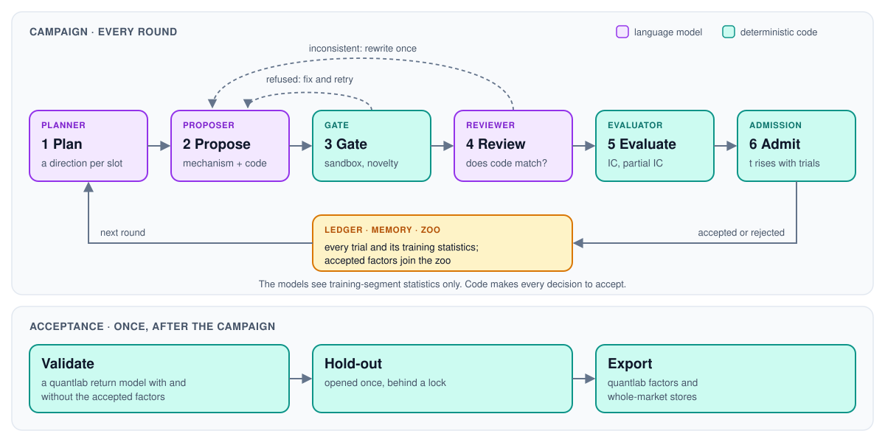
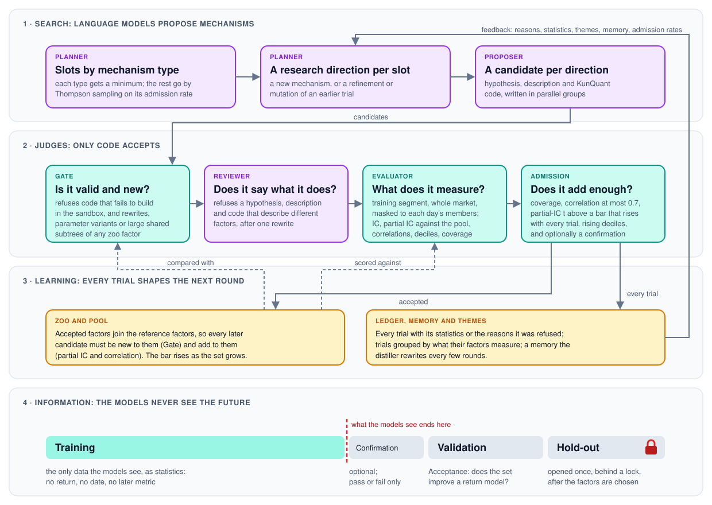

<p align="center">
  
</p>

<h1 align="center">quantlab-factor-agent</h1>

<p align="center">
  <a href="https://github.com/ZhaorongDai/quantlab-factor-agent/actions/workflows/ci.yml"></a>
  <a href="https://zhaorongdai.github.io/quantlab-factor-agent/"></a>
  <a href="LICENSE"></a>
  <a href="https://www.python.org/downloads/"></a>
  <a href="https://github.com/ZhaorongDai/quantlab"></a>
  <a href="https://github.com/Menooker/KunQuant"></a>
</p>

<p align="center">English | <a href="https://github.com/ZhaorongDai/quantlab-factor-agent/blob/main/README.zh-CN.md">简体中文</a></p>

quantlab-factor-agent mines daily stock factors with language models, mechanism first. A
model states an economic mechanism and writes the factor it implies as KunQuant code. Fixed
checks and statistics from [quantlab](https://github.com/ZhaorongDai/quantlab) then decide
whether the factor is new and adds to the factors you already have. The model only proposes
and reviews, and it sees nothing but the training segment.

[Documentation](https://zhaorongdai.github.io/quantlab-factor-agent/) ·
[Example configs](configs/) · [Changelog](CHANGELOG.md)

> **Status: alpha (0.x).** The API, the config format and the run directory's layout may
> change between minor versions.

## How it works

<p align="center">
  
</p>

A campaign runs in rounds. The planner picks one research direction per slot, and the
proposer writes a hypothesis, a description and KunQuant code for each. The Gate builds the
code in a sandbox and refuses rewrites of existing factors; the reviewer checks that
hypothesis and code describe the same factor. The Evaluator then scores what is left on the
training segment, and admission accepts or rejects it. After the campaign, `Acceptance`
trains a quantlab return model with and without the accepted factors, opens the hold-out
once and exports the chosen factors.

- **Mechanism first.** The Gate compares KunQuant graphs and refuses
  rewrites, parameter-only variants and large shared subtrees of every reference, known and
  accepted factor.
- **No look-ahead.** Prompts carry training-segment statistics only: no return, no date, no
  validation or hold-out metric. The hold-out opens once, behind a lock.
- **Only code accepts.** The Evaluator scores candidates on quantlab's
  whole-market panels, masked to each day's members, and the partial-IC t threshold
  tightens with every evaluated trial.
- **Nothing hard-coded about the market.** Fields, operators, prompts, mechanism types and
  scoring come from the config's files, so a new input family is a new field file.
- **Any provider, replayable.** Each role picks its backend: OpenAI-compatible endpoints
  (DeepSeek, OpenAI, vLLM, ...), Anthropic or Claude Code. Every call is logged, and the
  `replay` backend reproduces a run byte for byte without a provider.
- **Resumable.** `run()` picks up from the run directory after a crash or an exhausted
  balance.

The diagram below shows how the parts fit together: what the models search, what each
judge refuses, how every trial feeds the next round, and where the data the models see
ends. [How the agent mines factors](docs/user-guide/mechanism.md) explains it in full.

<p align="center">
  
</p>

With themes turned on, the planner also reads a map of the directions tried so far; see
[the direction map](docs/user-guide/mechanism.md#3-learning-every-trial-shapes-the-next-round).

## Install

You need Python 3.13+, [uv](https://docs.astral.sh/uv/), a C++ compiler on the `PATH`
(KunQuant compiles factor graphs to native code) and a checkout of quantlab beside this one:

```bash
git clone https://github.com/ZhaorongDai/quantlab.git
git clone https://github.com/ZhaorongDai/quantlab-factor-agent.git
cd quantlab-factor-agent
uv sync --extra web      # --extra web adds the factor-agent-web frontend
uv run pytest -n auto    # offline: no LLM call, a synthetic market
```

On macOS, xgboost also needs `brew install libomp`. Keys come from environment variables
only (`ANTHROPIC_API_KEY`, or the variable a role's `api_key_env` names), and a config that
holds a key is refused. See [installation](docs/getting-started/installation.md).

## Run a campaign

```python
from factor_agent.acceptance import Acceptance
from factor_agent.campaign import Campaign
from factor_agent.config import CampaignConfig

config = CampaignConfig.from_file("configs/us3000_ret5.yaml")
result = Campaign(config).run()          # resumes when run_dir already holds a state
print(result.stop, len(result.accepted), "accepted of", len(result.records))

report = Acceptance(config).validate()   # baseline vs baseline + accepted, on validation
print(report.markdown())
```

Point the config's data paths at your own quantlab stores first. A campaign runs for hours,
mostly waiting on the model, and needs no GPU; `Acceptance` uses CUDA when it is available.
Watch a run in the browser with `factor-agent-web` ([web frontend](docs/user-guide/web.md)).

## Documentation

- [How the agent mines factors](docs/user-guide/mechanism.md): the search, the judges, the learning loop and what the models may see, in one diagram
- [First campaign](docs/getting-started/quickstart.md): run one and read its outcome
- [Concepts](docs/user-guide/concepts.md): roles, factor sets, segments, what "accepted" means
- [The campaign config](docs/user-guide/campaign.md): every section, stopping and resuming
- [The vocabulary](docs/user-guide/vocabulary.md) and [prompts](docs/user-guide/prompts.md): what candidates may read and write, and what the models are told
- [LLM backends](docs/user-guide/llm-backends.md): providers, the LLM log, replay, cost
- [Gate, review and evaluation](docs/user-guide/evaluation.md) and [acceptance](docs/user-guide/acceptance.md): how a factor is judged

## Contributing

Bug reports, questions and pull requests are welcome; see [CONTRIBUTING.md](CONTRIBUTING.md).
Report security problems privately, as [SECURITY.md](SECURITY.md) describes.

## License

[MIT](LICENSE). `factor_agent/_max_drawdown.py` adapts code from
[KunQuant](https://github.com/Menooker/KunQuant) under the
[Apache License 2.0](factor_agent/KUNQUANT_LICENSE).
