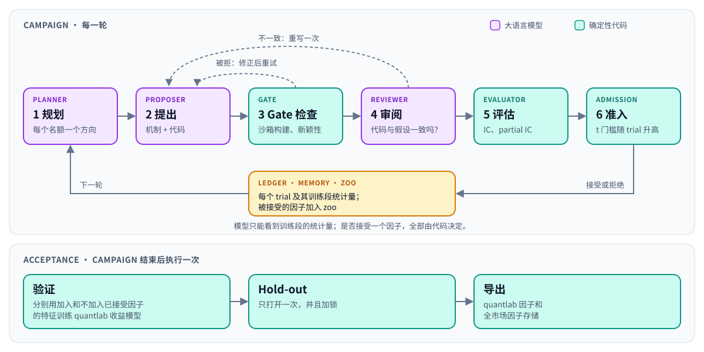
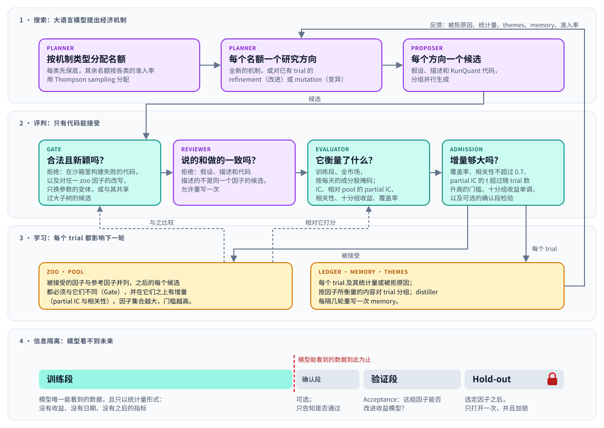
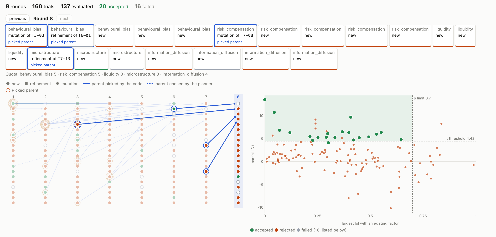
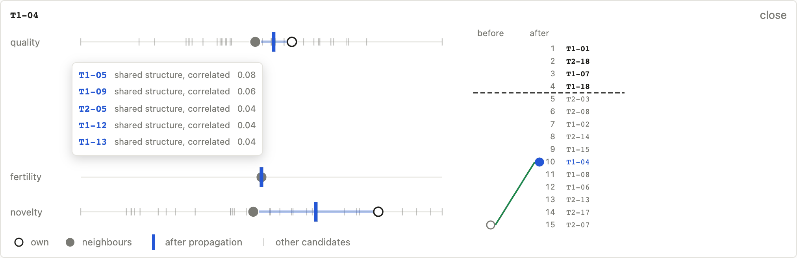

<p align="center">
  
</p>

<h1 align="center">quantlab-factor-agent</h1>

<p align="center">
  <a href="https://github.com/ZhaorongDai/quantlab-factor-agent/actions/workflows/ci.yml"></a>
  <a href="https://zhaorongdai.github.io/quantlab-factor-agent/"></a>
  <a href="https://pypi.org/project/quantlab-factor-agent/"></a>
  <a href="https://www.python.org/downloads/"></a>
  <a href="https://zhaorongdai.github.io/quantlab-factor-agent/getting-started/installation.html"></a>
  <a href="https://github.com/ZhaorongDai/quantlab-factor-agent/blob/main/LICENSE"></a>
  <a href="https://github.com/ZhaorongDai/quantlab-factor-agent/blob/main/CHANGELOG.md"></a>
  
  <a href="https://github.com/ZhaorongDai/quantlab"></a>
  <a href="https://github.com/Menooker/KunQuant"></a>
</p>

<p align="center"><a href="README.md">English</a> | 简体中文</p>

quantlab-factor-agent 用大语言模型挖掘日频股票因子，从经济机制出发。模型先提出一个经济机制，
再把这个机制对应的因子写成 KunQuant 代码；之后由固定的检查和
[quantlab](https://github.com/ZhaorongDai/quantlab) 计算的统计量来判断：这个因子是不是新的，
相对你已有的因子有没有增量。模型只负责提出和审阅，它能看到的只有训练段。

[文档](https://zhaorongdai.github.io/quantlab-factor-agent/)（英文）·
[示例配置](configs/) · [更新日志](CHANGELOG.md)

> **状态：alpha（0.x）。** API、配置格式和运行目录的结构在次版本之间都可能变化。

## 工作方式

<p align="center">
  
</p>

一次 campaign 按轮进行。planner 为每个名额选一个研究方向，proposer 为每个方向写出假设、描述和
KunQuant 代码。Gate 在沙箱里构建代码，拒绝对已有因子的改写；reviewer 检查假设和代码说的是不是同
一个因子。剩下的候选由 Evaluator 在训练段上打分，再由 admission 决定接受还是拒绝。campaign 结束后，
`Acceptance` 分别用加入和不加入已接受因子的特征训练 quantlab 收益模型，只打开一次 hold-out，
然后导出选定的因子。

- **机制优先。** Gate 比较 KunQuant 计算图，拒绝对任一参考因子、已知因子和已接受因子的改写、
  只换参数的变体，以及共享过大子树的候选。
- **不偷看未来。** 提示词里只有训练段的统计量：没有收益、没有日期、没有验证段或 hold-out 的指标。
  hold-out 只打开一次，并且加锁。
- **只有代码能接受因子。** Evaluator 在 quantlab 的全市场面板上为候选打分，按每天的成分股掩码；
  partial IC 的 t 门槛随每个已评估的 trial 升高。
- **不写死任何市场假设。** 字段、算子、提示词、机制类型和打分方式都来自配置文件，
  接入一类新数据只需要一个新的字段文件。
- **任意模型提供方，可重放。** 每个角色可以单独选后端：OpenAI 兼容接口（DeepSeek、OpenAI、
  vLLM 等）、Anthropic 或 Claude Code。每次调用都完整记录，`replay` 后端不需要模型提供方就能逐字节
  复现一次运行。
- **可续跑。** 程序崩溃或余额耗尽后，`run()` 从运行目录接着跑。

下图说明各部分如何配合：模型搜索什么、每个评判环节拒绝什么、每个 trial 如何反馈到下一轮，以及模型
能看到的数据止于哪里。完整说明见 [How the agent mines factors](docs/user-guide/mechanism.md)（英文）。

<p align="center">
  
</p>

打开 themes 后，planner 还会读取一张“方向地图”，记录已经试过哪些方向，见
[the direction map](docs/user-guide/mechanism.md#3-learning-every-trial-shapes-the-next-round)（英文）。

## 安装

需要 Python 3.13+ 和 `PATH` 上的 C++ 编译器（KunQuant 会把因子图编译成本地代码）：

```bash
pip install "quantlab-factor-agent[web]"   # [web] 安装 factor-agent-web 前端
```

如果要改代码，或者运行示例配置和离线测试，用 [uv](https://docs.astral.sh/uv/) 从源码安装，
并把 quantlab 放在本仓库旁边：

```bash
git clone https://github.com/ZhaorongDai/quantlab.git
git clone https://github.com/ZhaorongDai/quantlab-factor-agent.git
cd quantlab-factor-agent
uv sync --extra web
uv run pytest -n auto    # 离线运行：不调用大模型，使用合成行情
```

在 macOS 上，xgboost 还需要 `brew install libomp`。密钥只从环境变量读取（`ANTHROPIC_API_KEY`，
或某个角色的 `api_key_env` 指定的变量），包含密钥的配置会被拒绝。详见
[安装说明](docs/getting-started/installation.md)（英文）。

## 运行一次 campaign

```python
from factor_agent.acceptance import Acceptance
from factor_agent.campaign import Campaign
from factor_agent.config import CampaignConfig

config = CampaignConfig.from_file("configs/us3000_ret5.yaml")
result = Campaign(config).run()          # run_dir 里已有状态时会续跑
print(result.stop, len(result.accepted), "accepted of", len(result.records))

report = Acceptance(config).validate()   # 在验证段上比较基线与基线 + 已接受因子
print(report.markdown())
```

先把配置里的数据路径改成你自己的 quantlab 数据。一次 campaign 要跑几个小时，大部分时间在等模型
返回，不需要 GPU；`Acceptance` 在有 CUDA 时会使用它。长时间运行之前，`factor-agent check <config>`
会在几秒内报告 `run()` 会拒绝的所有问题（不存在的数据存储、未设置的 API 密钥变量、续跑时改动了配置等），
不写入任何文件；加上 `--ping` 还会向每个后端发一次简短请求。

## 在浏览器里查看运行

```bash
factor-agent-web runs/    # 然后打开 http://127.0.0.1:8000
```

web 面板列出你的所有运行并逐个打开：已接受的因子能否改进你的模型、每个因子一张卡片、Lineage 图和
admission 图上的每个 trial、进行中那一轮的大模型调用、memory 和配置。它只读取运行目录，只监听本机；
在服务器上运行时通过 SSH 隧道访问。详见 [The web frontend](docs/user-guide/web.md)（英文）。

<p align="center">
  
</p>

## 在已有 trial 的基础上继续

第一轮之后，每个 trial 要么开启新方向，要么建立在更早的某个 trial（它的 parent）之上，作为 refinement
或 mutation。一个 trial 的 **Lineage** 概括了建立在它之上的 trial：有多少个、多少个提前终止、哪些被接受、
最好的那个走了多远。打开 `context.lineage` 后，planner 和 proposer 会读到它。设置 `round.picked_parents: k`
后，每轮有 k 个名额的 parent 由代码而不是 planner 选择，即 **Picked parents**：代码按质量、繁殖力和新颖性
给已评估的 trial 排序，每项都在 **Trial graph**（按生成关系、代码结构和相关性连接的 trial）上与相关的 trial
共享，所以亲属表现好的 trial 会跟着上升。`trial_graph` 配置段决定共享多少以及图如何构建。web 面板的
“why these parents”按轮展示传播如何改变每个 trial 的效用和排名：

<p align="center">
  
</p>

详见 [Building on earlier trials](docs/user-guide/concepts.md#building-on-earlier-trials) 和
[the campaign config](docs/user-guide/campaign.md#settings-with-defaults)（英文）。

## 文档

文档目前只有英文：

- [How the agent mines factors](docs/user-guide/mechanism.md)：用一张图讲清搜索、评判、学习闭环，以及模型能看到哪些数据
- [First campaign](docs/getting-started/quickstart.md)：跑一次 campaign 并解读结果
- [Concepts](docs/user-guide/concepts.md)：角色、因子集合、数据段，以及什么叫“被接受”
- [The campaign config](docs/user-guide/campaign.md)：配置的每个部分、检查配置、停止与续跑
- [The web frontend](docs/user-guide/web.md)：面板的每个页面，以及如何在服务器上访问
- [The vocabulary](docs/user-guide/vocabulary.md) 和 [prompts](docs/user-guide/prompts.md)：候选能读写什么，模型被告知什么
- [LLM backends](docs/user-guide/llm-backends.md)：模型提供方、调用日志、重放、成本
- [Gate, review and evaluation](docs/user-guide/evaluation.md) 和 [acceptance](docs/user-guide/acceptance.md)：因子如何被评判

## 参与贡献

欢迎提交问题反馈、提问和 pull request，见 [CONTRIBUTING.md](CONTRIBUTING.md)（英文）。
安全问题请按 [SECURITY.md](SECURITY.md)（英文）私下报告。

## 许可证

[MIT](LICENSE)。`factor_agent/_max_drawdown.py` 改编自 [KunQuant](https://github.com/Menooker/KunQuant)
的代码，该部分采用 [Apache License 2.0](factor_agent/KUNQUANT_LICENSE)。
