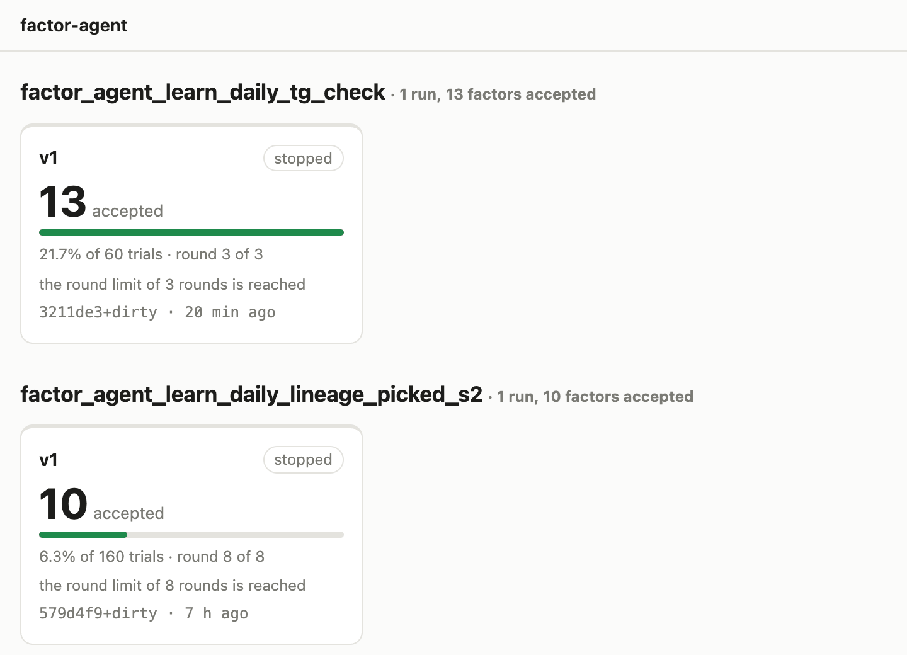
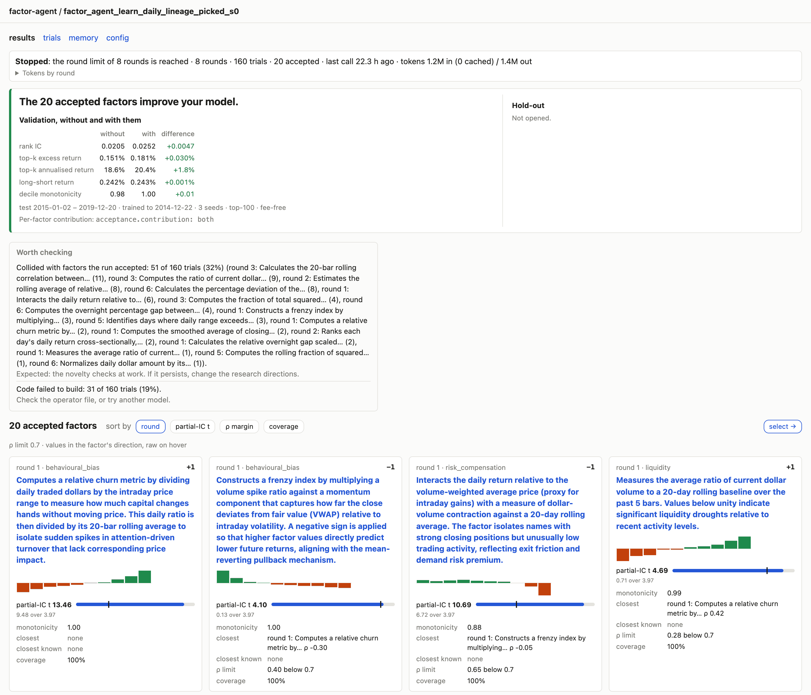
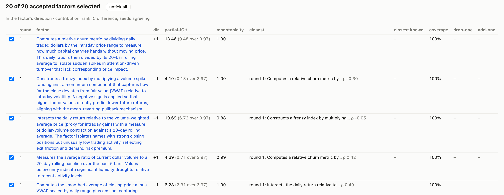
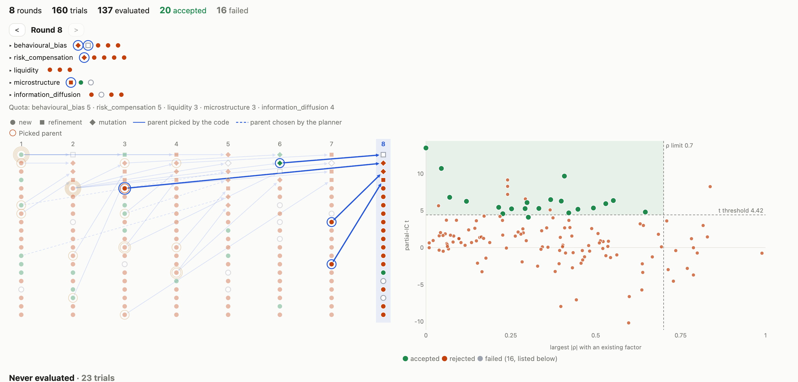
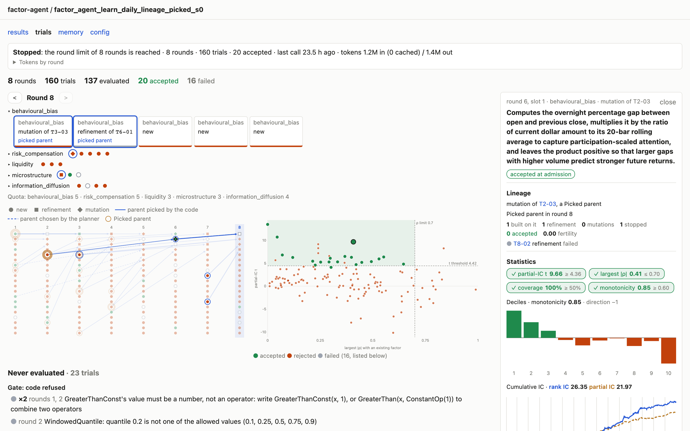
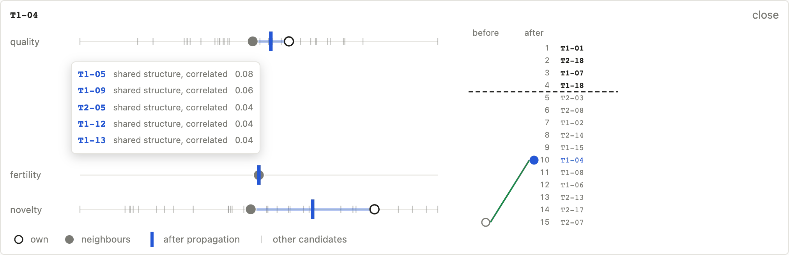
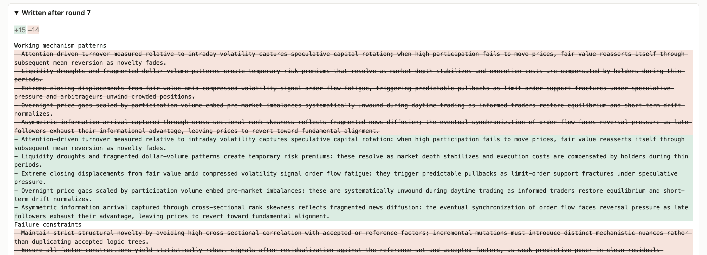
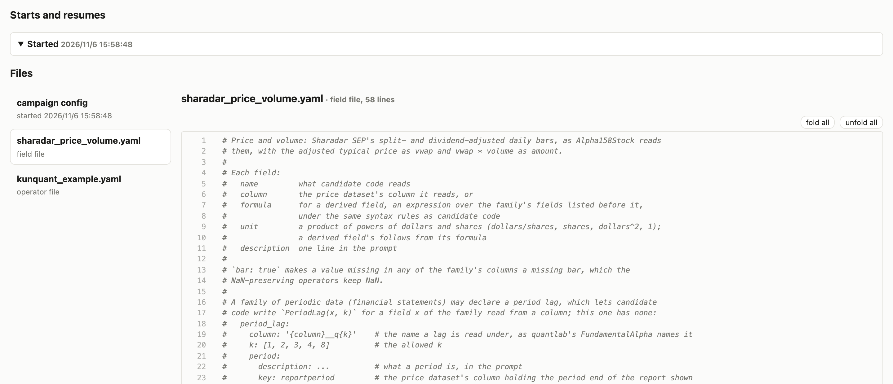

# The web frontend

The frontend is a page on your own machine that lists the runs under a folder and opens
each of them, so that you can look at a run without reading its files. It only reads: it
never writes to a run directory, starts or stops a campaign, or runs Acceptance.

## Install

The frontend's web service (FastAPI and uvicorn) comes with the optional `web` extra:

```bash
pip install "quantlab-factor-agent[web]"   # or, in a checkout: uv sync --extra web
```

The page is built and kept in the package, so serving it needs no Node. Only changing the
page does: edit `frontend/`, run `npm ci && npm run build` there with Node 22 and commit
the rebuilt `factor_agent/web/static/`. CI fails when the build differs from the committed
one; `npm test` needs Node 22.6 or newer.

## Start it

Point `factor-agent-web` at the folder that holds your run directories (the `run_dir` of
your configs), at any depth, or at a single run directory:

```bash
factor-agent-web runs/
```

It serves the page on <http://127.0.0.1:8000>; `--port` picks another port. It listens on
localhost only: the pages show your prompts, code and statistics, and there is no login.
Stop it with Ctrl-C. To watch a campaign on a server, see [on a server](#on-a-server).



The run list shows every run directory under the folder, as cards grouped by series, the
series last active first. A run named `<series>_v<N>` is version N of its series, so
`campaign`, `campaign_v2` and `campaign_v3` sit side by side. A card's state is "running",
"crashed" (the process exited without recording a stop), "stopped", or "not stopped" when
the process cannot be checked (an older run, or one started on another machine); the
acceptance rate's bar is drawn against the best rate listed, and the last line is the
commit the run was last started or resumed with. A round counts once it is written at the
round's end. Click a card to open the run on its results. A run whose files cannot be read
is listed as unreadable, with the file and the reason.

## The health line

Every page of a run starts with its health line, read from the run's events file (see
{doc}`campaign`, "The events file"): stopped and why, or what the running campaign is
doing in its round (planning, asking the LLM, evaluating), how long ago the last LLM call
came back, about how long the remaining rounds would take at the pace of the last three,
and the tokens so far (input, cached, output and reasoning; "Tokens by round" opens them
by round). There are no prices: spending limits belong to your provider.

Two warnings can appear. **Crashed**: the process exited without recording a stop; running
the campaign again resumes it. **May be stuck**: no LLM call was sent or came back for 15
minutes while asking the LLM (an evaluation is never reported stuck, since its length
follows the data). The process is looked for only on the machine the frontend runs on, so
from another machine it is reported as unknown, never as gone. A run without an events
file (an older version's) says only which roles have answered how many times.

The page reads the run again whenever it writes, checking every 5 seconds, and the tab's
title counts the factors accepted since the page was opened. While the run is going,
**Pause** holds the page still to read a running round; a bar says since when and whether
the run has changed, and **Resume** reads it again at once.

## The results page



The sentence at the top says whether the accepted factors improve your model, from
{doc}`acceptance`'s validation report: they do when the seed-averaged rank IC and top-k
excess return both rise with them. Beside it, once the hold-out has been opened, is the
same comparison on the hold-out with every open the lock records; one opened again with
force is marked in red, since it no longer tests the factors out of sample. Before
Acceptance has run, the page shows the call that judges them.

Each card is one accepted factor (see {doc}`evaluation` for each statistic): its round and
mechanism type, its factor direction (+1 when a higher value went with a higher training
return), its decile returns, its partial-IC t against the threshold it cleared, its decile
monotonicity, the closest reference or accepted factor and the closest known factor, how
far its largest correlation is below the limit (ρ margin), its coverage and, with
`acceptance.contribution`, its drop-one and add-one rank IC with the seeds agreeing.
Every IC and t is in the factor's direction; hover one for the raw value. An `intraday`
tag marks an [intraday](intraday.md) factor.

The cards rank by drop-one contribution when there is one, and sort by round, partial-IC
t, ρ margin or coverage. Click a description to read the factor written up: its
statistics and charts, hypothesis, description, code and trust facts in sentences.

Thresholds and the correlation limit come from the events file. A run without one takes
them from the refusals that quote them, and a card says when its threshold was quoted
that way or carried over from an earlier round.

### The diagnosis

"Worth checking" lists at most three findings, each a thing seen in the run's trials and
what to do about it, the one concerning the most trials first:

| Finding | When | What to do |
|---------|------|------------|
| the LLM's replies could not be read | more than 20% of the trials | change the model, or raise its output limit |
| candidates keep colliding with one of your known factors | more than 5 trials with the same one | steer the directions away from it, or check your known factors |
| candidates collide with factors the run accepted | more than 5 trials in all | nothing: the novelty checks are at work |
| candidates cover too few members | more than 15% of the trials refused for coverage | check your data's fields and dates |
| candidate code fails to build | more than 15% of the trials | check the operator file, or the model |
| nothing accepted, below the t threshold | most evaluated trials refused below it | nothing: this is the statistical bar |

Shares count trials, not their versions. A collision is a refusal for being too like an
existing factor (see {doc}`concepts`); a repeat of the run's own earlier candidate is not
one, and collisions with the reference set are no finding.

## The selection view



The results page's *select →* opens the accepted factors as a table, every row ticked; a
row opens to the factor's hypothesis and code. Beside the table are the {doc}`acceptance`
calls for the ticked factors, to copy into Python on the machine that holds the run:
validate the selection, open the hold-out on it and export it. Export names are the
descriptions' first words, to replace with your own, and the config path is a
placeholder. Once the hold-out lock records an open, the view warns that the hold-out is
no longer untouched and writes the call to open it again with `force=True` commented out,
so a pasted block never reopens it. The page runs none of these calls.

## The trials page



The bar at the top counts the run's rounds, trials, evaluated, accepted and failed trials.

**The round stepper** shows one round's plan, the latest by default; the `<` and `>` arrows
step through the rounds, the round in progress included. The slots are grouped by mechanism
type, each group folded to one mark per slot in the Lineage graph's shapes and colours (a
blue ring for a picked parent); click a type to open its slots. Each slot shows its mechanism
type and action (new, refinement or mutation of a parent), its outcome as the colour of its
lower edge (grey while pending), and "picked parent" with a blue outline when the code
chose that parent (`round.picked_parents`, see {doc}`campaign`) rather than the planner.
Under the slots come the quota by mechanism type and any issues the plan raised. Click a
slot or a mark to read its trial. Hovering a slot lights its trial in the Lineage graph and
the admission map, and hovering a trial there lights its slot; selecting a trial of the
stepped round in either chart opens its group.

**The Lineage graph** draws every trial in a column of its round: circle new, square
refinement, diamond mutation; green accepted, red refused, hollow when it stopped before
evaluation, dashed while pending. An arrow joins each parent to its child, solid when the
code picked the parent and dashed when the planner chose it. A Picked parent wears a thin
ring per round it was picked in, the innermost for the first; the stepped round's ring is
blue and its Picked parents' arrows bold. With nothing selected the stepped round and its
parents stand out; with a trial selected, its ancestors and descendants do. Click a
round's number to step to it, a node to read it, or a ring to open
[why these parents](#why-these-parents) on that round.

**The admission map** places every evaluated trial by its largest absolute correlation
with an existing factor (across) and its partial-IC t in its direction (up), as admission
judges them (see {doc}`evaluation`). The dashed lines are the correlation limit and the
latest round's t threshold; the shaded region is where admission accepts, when coverage
and monotonicity pass too. Each round had its own threshold, rising with the trials
evaluated, so an early accepted trial can sit below the final line. New trials stand out
for fifteen seconds.

Under the map, the trials that never reached the Evaluator are grouped by the stage that
refused them (parser, Gate, reviewer, then code the Evaluator could not build) and by
reason, one row per reason with its count and rounds; click a row to list its trials.

### Reading a trial



Clicking a node, a point or a slot opens the trial in the side panel and marks it on the
graph and the map; "close" gives the width back. The panel shows the round, mechanism type
and direction; its **Lineage**: the parent it builds on (a link) and who chose it, the
rounds it was a Picked parent in, how many trials were built on it (refinements, mutations,
stopped before evaluation, accepted), its fertility over the run's
`context.fertile_children`, its own partial-IC t against its best child's, and each child;
then the hypothesis, description and code of its final version, why it was refused, its
earlier versions with the Gate's reasons and hints, and, when evaluated, its statistics:

- **checks**: partial-IC t, largest correlation, coverage and monotonicity, green when
  they cleared the bar admission set, red when not, grey "?" when the run does not record
  the bar;
- **decile returns**: each tenth of the daily cross section over the deciles' mean, which
  in the factor's direction should rise to the right;
- **cumulative IC**: the running daily rank IC and partial IC (dashed) over the training
  days; a partial IC far below the rank IC is an effect the existing factors already
  explain.

### Why these parents



A round that picked its parents on the Trial graph (see {doc}`concepts`, "Building on
earlier trials") shows "why these parents" by the stepper, which opens the propagation
view under the graph; a click on a Picked parent's ring opens it on that trial and round.
With nothing selected it lists the round's Picked parents, each with its rank before and
after propagation; click one to select it.

For the selected trial, each utility (quality, fertility, novelty) gets an axis with its
own value (hollow dot), its neighbours' average (dot) and its value after propagation
(bar), which lies `trial_graph.gamma` of the way from the first to the second; the faint
ticks are the other candidates. Hover the neighbours' dot to list the heaviest neighbours,
each with its total weight and relations (parent or child, shared structure, correlated);
click one to select it. The rank ladder lists the ranks after propagation, with a dashed
pick line under the last Picked parent, and joins the trial's rank before to its rank
after; a rank past the ladder is written below it. A trial that could not be picked says
why (at the expansion cap, or at the cap on children). The ranks are the campaign's own
pick order, read from `trial_graph/round_NN.json`, so a run without Picked parents, or
made before the graph files, has no view.

### The round in progress

While the campaign runs, the round in progress sits between the bar and the stepper as a
timeline of its LLM calls, one lane per role (planner, proposer, reviewer) and one for the
evaluation. A call still waiting is drawn open, a failed one is marked, and calls asked
side by side get rows of their own. Click a call to read its role, model, timing, tokens,
reply, reasoning (when the provider returns it) and prompt; a flag says when the reply was
cut off at the output limit or was empty. "Pending trials" opens one card per slot with
the stage it reached (planned, proposed, fixed after the Gate, rewritten after review,
found consistent or not). After a crash the round is marked as cut short; resuming drops
it and runs it again under the same number. A run without an events file shows neither.

## The memory page



Every `round.memory_every` rounds the distiller folds the trials since its last version
into the memory every later prompt carries (see {doc}`campaign`). The page lists each
version by the round after which it was written, the latest first, with added lines
highlighted and removed ones struck through; "Text" shows it as the prompts carry it.

## The config page



The config of every start and resume, the latest first; a resume that changed the config
shows the changed lines. Below, a file browser opens each config in full and the run's
snapshot files: the field files, the operator file and any replaced prompt templates. A
key with lines under it folds with the arrow beside it, and "fold all" and "unfold all"
fold or open every one.

## On a server

When the campaign runs on a server, start the frontend there and forward its port to your
laptop over SSH:

```bash
# on the server
factor-agent-web /path/to/runs

# on your laptop
ssh -N -L 8000:localhost:8000 user@server.example.com
```

Then open <http://localhost:8000> on your laptop. The page is reachable only through your
SSH connection; nothing is served to the server's network.
